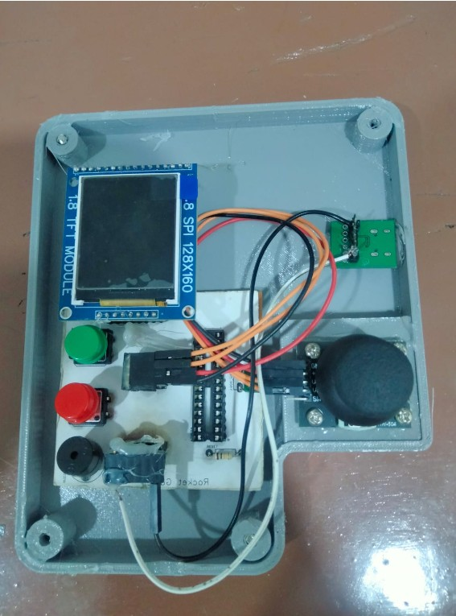
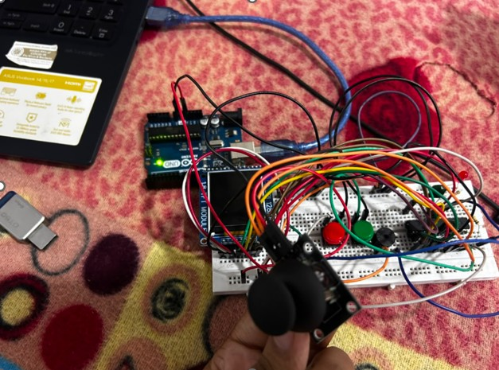
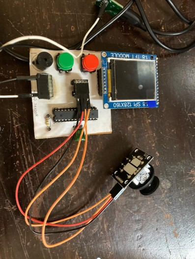
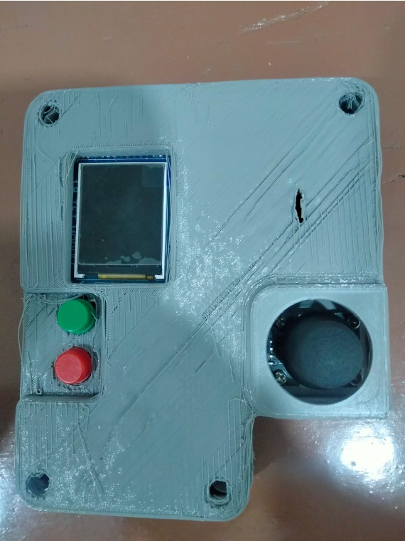

# Rocket Game – ATmega328P Handheld Alien Shooter

A standalone handheld arcade shooter running on a bare **ATmega328P** microcontroller on a custom-designed PCB. Move your rocket with a joystick, shoot waves of aliens, and survive as many levels as you can. Written in C with **avr-gcc**, programmed with a **USBasp**.


▶ **Demo video:** [Watch the demo](videos/demo.mp4)



## Features

- Runs entirely on a single ATmega328P (internal 1 MHz clock, no external crystal)
- 1.8" 128×160 ST7735 colour TFT display over SPI
- Analog thumb joystick for movement, with separate Start/Restart and Shoot buttons
- 9 levels, 3 lives, live score / level / lives display
- Aliens with different health, shown by colour, getting faster and shooting more often each level
- Buzzer sound effects for firing, hits, level clear and game over
- Custom PCB, USB-C 5 V power, and a 3D-printed case

## Photos

| Breadboard prototype (Arduino Uno) | Custom PCB |
|---|---|
|  |  |

| Assembled, open | Assembled, closed |
|---|---|
|  |  |

## Hardware

### Components

| Part | Notes |
|---|---|
| ATmega328P (DIP-28) + 28-pin IC socket | Main microcontroller |
| 1.8" TFT module, ST7735S, 128×160 | SPI interface |
| Thumb joystick module | X/Y axes read with the ADC |
| 2× tactile push buttons | Green = Start/Restart, Red = Shoot |
| Passive buzzer | Driven through a 100 Ω resistor |
| USB Type-C breakout board | 5 V power only |
| 2× 100 nF capacitors | Decoupling on VCC and AVCC |
| 10 kΩ resistor | Pull-up on RESET (pin 1) |
| Female headers | For display and joystick connections |

The full parts list with photos is in [`hardware/RocketGame_components.pdf`](hardware/RocketGame_components.pdf) and the PCB layout is in [`hardware/RocketGame_PCB.pdf`](hardware/RocketGame_PCB.pdf).

### Pin connections

| Function | ATmega328P pin | Port |
|---|---|---|
| TFT RST | 14 | PB0 |
| TFT D/C | 15 | PB1 |
| TFT CS | 16 | PB2 |
| TFT DIN (MOSI) | 17 | PB3 |
| TFT CLK (SCK) | 19 | PB5 |
| Joystick VRx | 23 | PC0 / ADC0 |
| Joystick VRy | 24 | PC1 / ADC1 |
| Start / Restart button (to GND) | 25 | PC2 |
| Shoot button (to GND) | 26 | PC3 |
| Buzzer (via 100 Ω) | 5 | PD3 |
| VCC / AVCC | 7 / 20 | +5 V |
| GND | 8 / 22 | GND |

TFT VCC and BL (backlight) go to +5 V. Joystick VCC goes to +5 V and joystick SW is not used.

## Building and flashing

### Requirements

- `avr-gcc`, `avr-libc` and `make` (WinAVR, or the AVR toolchain for your OS)
- `avrdude`
- A USBasp programmer

### Build

```bash
cd firmware
make clean
make all
```

This produces `Rocket_Game.hex`.

### Flash

```bash
avrdude -p atmega328p -c usbasp -B 3 -U flash:w:Rocket_Game.hex
```

The `make program` target does the same, but it uses `sudo`, so it is meant for Linux. On Windows, run the `avrdude` command above directly.

The chip runs from its internal oscillator at 1 MHz (`F_CPU = 1000000`), so no fuse changes are needed.

## How to play

1. Connect 5 V power through the USB-C port. The title screen appears.
2. Press the **green** button to start.
3. Move with the **joystick**, shoot with the **red** button.
4. Clear every alien to move to the next level. You have 3 lives.
5. When the game ends, press the **green** button to restart.

Alien colour shows its health: red takes 3 hits, orange takes 2, and lime, magenta and yellow take 1.

The full guide is in [`docs/Rocket_Game_User_Manual.pdf`](docs/Rocket_Game_User_Manual.pdf).

## Project structure

```
Rocket-Game-ATmega328P/
├── firmware/    Source code (Rocket_Game.c) and Makefile
├── hardware/    PCB layout and components list
├── docs/        User manual
└── images/      Photos of the project
```

## Development notes

The game was first prototyped on a breadboard with an Arduino Uno and the same display, joystick, buttons and buzzer. It was then moved onto a custom PCB with a bare ATmega328P programmed through USBasp.

## License

MIT License. Copyright (c) 2026 <YOUR NAME>
